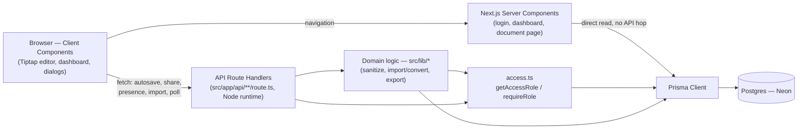
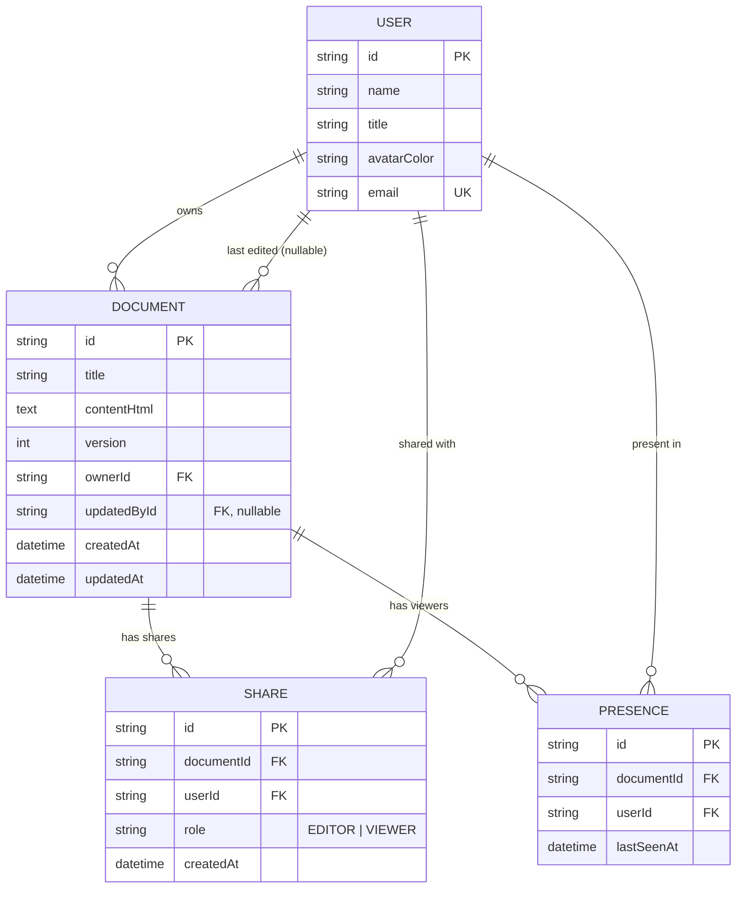

# Architecture & Rationale

## What I prioritized, and why

Given a 4–6 hour timebox, I chose **one deep working slice over broad shallow coverage**: a real document CRUD + rich-text editing flow with autosave, server-enforced access control, and optimistic-concurrency conflict detection, built and manually verified end to end — rather than stub implementations of every feature in the brief. Import, sharing, presence, export, and the ready-to-share check were then layered on in priority order against the remaining time budget (see `DECISIONS_LOG.md` for the phase-by-phase record). Deliberately cut: real-time collaborative merging, comments, and full version history — see below.

## Architecture

Server Components read Prisma directly for the dashboard, the auth gate, and opening a document — no API round-trip for pure reads. Everything interactive that runs after mount (autosave, the conflict poll, presence heartbeats, sharing, import) goes through a real route handler under `/api`, because it's client-initiated and needs the same access check every time.

## Data model

Design reasons:

- **Owner lives on `Document.ownerId`, not a `Share` row** — OWNER is always derived, never duplicated or spoofable via a Share entry. `Role` only has `EDITOR`/`VIEWER`.
- **`Share` has a composite unique key `(documentId, userId)`** — one role per user per document, which makes granting/changing a role a single idempotent `upsert` (`PUT`).
- **`version` is a plain `Int`, not a timestamp** — a stale PATCH is caught with one atomic `updateMany({ where: { id, version } })`: either it matches (count=1, version increments) or it doesn't (count=0 → 409 with the latest doc), with no timestamp-precision race window.
- **`Presence` lives in Postgres, not an in-memory `Map`** — Vercel serverless function instances don't share memory, so an in-process store would silently miss heartbeats handled by a different instance.
- **Indexes match the actual queries:** `Document(ownerId, updatedAt desc)` for the dashboard's "my documents" list, `Share(userId)` for "shared with me", `Presence(documentId, lastSeenAt)` for the active-viewers window.
- **Cascades:** `Share` and `Presence` both cascade-delete when their `Document` or `User` is removed, so a deleted document/user never leaves orphaned access-control or presence rows. `updatedBy` is `onDelete: SetNull` — removing a user doesn't break their old documents, it just loses that one attribution.
- **404 vs 403:** `getAccessRole` returns `null` for no access; `requireRole` turns that into a 404 (hides existence) and a granted-but-wrong-role caller into a 403.

## Key decisions

| Decision | Alternatives rejected | Why |
|---|---|---|
| Server Components read Prisma directly; API routes only for writes/polling | A GET route for every read | Lower TTFB for pure reads; client-initiated calls still need a real endpoint to re-check access on every call |
| HMAC-signed httpOnly cookie, seeded profile picker | NextAuth/Clerk, real password+email auth | Brief explicitly allows mocked/seeded login to keep scope reasonable; the cookie is still a genuine signed, `timingSafeEqual`-verified, 7-day session |
| Integer `version` + atomic conditional `updateMany` | Timestamp compare, WebSocket live sync, CRDT/OT | Removes a timestamp-precision race; satisfies "don't silently overwrite" without collaborative-editing infra that's out of scope |
| Presence rows in Postgres | In-memory `Map` on the server | Serverless instances don't share memory — an in-process store would miss other instances |
| One `lib/access.ts` chokepoint for every permission check | Re-deriving ownership/role inline per route | Every route agrees on the same 404-vs-403 semantics; one place to test |
| Content stored as sanitized HTML (Tiptap's native shape) | ProseMirror JSON; Markdown | No serialize/deserialize layer; the fixed sanitize-html allow-list is also what makes the hand-rolled Markdown exporter safe without a full HTML parser |
| Import converts files into real, editable Documents | Store the upload as an opaque attachment blob | Matches the brief's "product-relevant" framing — upload becomes a first-class document, not just file storage |
| Prisma pinned to 6.19.3 | Prisma 7 (what a plain install pulled) | Prisma 7 moves the datasource URL out of `schema.prisma` into a new driver-adapter config model — adopting that mid-assessment was riskier than pinning |
| Vercel + Neon both pinned to Singapore (`sin1` / `ap-southeast-1`) | Default regions | Co-locating app and DB cuts round-trip query latency |

## Deployment

- **Vercel** (app) + **Neon** (Postgres), connected through Vercel's GitHub Git integration — push to `main` auto-deploys. No Vercel API token or raw DB connection string was ever handed to the AI; environment variables were set directly in the Vercel dashboard.
- **Regions co-located:** Vercel function region `sin1` (pinned in `vercel.json`), Neon database region `ap-southeast-1` — both Singapore, to minimize the round-trip on every Prisma query.
- **Two connection strings:** `DATABASE_URL` (pooled, via PgBouncer — what the running app uses) and `DIRECT_URL` (direct — what Prisma Migrate needs for DDL/advisory locks).
- **Build:** `postinstall` runs `prisma generate`; the build script is `prisma migrate deploy && next build`, so every deploy applies any pending migration before building. One migration exists so far: `prisma/migrations/20261020123000_init`.
- **Runtime:** every API route declares `export const runtime = "nodejs"` — Prisma, `mammoth`, and `sanitize-html` all need Node APIs unavailable on the Edge runtime.

## Security

- **HTML sanitization:** `sanitize-html` with a fixed allow-list (`h1`–`h3`, `p`, `strong`, `em`, `u`, `ul`, `ol`, `li`, `br`, `a`; `a` limited to `href`/`rel`/`target`; schemes `http`/`https`/`mailto`) runs on every write that stores HTML — editor autosave and file-import conversion. No unsanitized HTML is ever persisted.
- **Session cookie:** httpOnly, `sameSite=lax`, `secure` in production; payload is a signed, base64url-encoded `{uid, exp}` JSON object, verified with `crypto.timingSafeEqual` (not `===`); 7-day expiry checked server-side on every request.
- **Access control:** every document-scoped route resolves the role server-side through `access.ts` — no route trusts a client-sent role.
- **File limits enforced server-side:** empty file → 422, over 2 MB → 413, unsupported extension → 415, corrupt `.docx` → 422 — checked in the route handler regardless of what the client claims.

## Deliberately cut, and why

| Cut | Why |
|---|---|
| Real-time collaborative editing (OT/CRDT, WebSockets) | Explicitly out of the brief's scope; "don't silently overwrite" is satisfied by 409s + a 10s poll, not live merging |
| Comments / suggestion mode | Not started — depth over breadth |
| Full version history | Only the last editor's name + conflict detection are kept, not stored snapshots |
| Real SSO/password auth | Brief explicitly allows seeded/mocked login |
| Global toast/notification system | Sharing uses inline error text + optimistic-UI rollback instead |
| Attachments as a separate concept from documents | Import always produces a full, editable Document |

## What changes at scale

- Replace the conflict-and-poll model with real collaboration: **Yjs/CRDT over WebSockets** so concurrent edits merge instead of racing on `version`.
- Move presence from a 10s Postgres poll to **Redis** (TTL keys + pub/sub) — doesn't scale well past a handful of concurrent viewers per document.
- Add **workspaces/memberships** instead of a flat seeded-user list, so sharing operates within an org boundary.
- Add a **`document_versions`** table (snapshot per save) for real history/restore, instead of just last-editor attribution.
- Add **`comments`** and **`audit_events`** tables for suggestion mode and an activity trail.
- Move file storage to **object storage** (S3/R2) once imports/attachments go beyond small text-like files.
- Replace the seeded-profile login with **real SSO** (OAuth/SAML) and per-organization provisioning.
